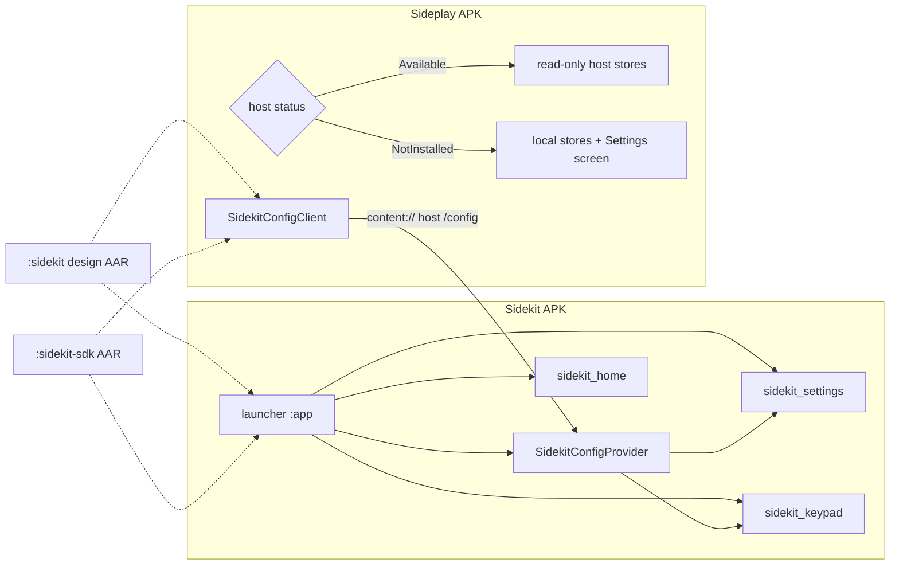

# Third-party apps and shared user configuration

**Status:** Implemented — tasks 1–5 done, including local publishing validation, the host-store factory, capability checks, the signing-certificate trust list, the About disclosure, the cross-UID permission test and GitHub Pages publication; first tagged release next
**Date:** 11 November 2026
**Branch:** `feat/third-party-apps`

Sideplay currently lives inside Sidekit as an in-process sub-app. The goal is to move it
to its own repository and APK while keeping Sidekit's design system, keypad behaviour and
launcher integration. Sideplay should read Sidekit's user configuration when Sidekit is
installed, and show its own theme and keyboard settings only when Sidekit is absent.

This document maps the work required in this repository. Sideplay-specific migration is
listed separately because it happens in the new repository.

## 0. Implementation checklist

Checked items are already in this branch. Unchecked items follow the recommended order in §8.

### 1. Contract and distribution

- [x] Split the SDK into two artifacts: `sidekit-design` and `sidekit-sdk`.
- [x] Use the public `normal` read-configuration permission, backed by a signing-certificate
  trust list (`TrustedCallers`, `res/values/trusted_apps.xml`): the permission records intent,
  the certificate decides. The same list gates Sidekit-native launcher tiles.
- [x] Choose the artifact host: GitHub Pages serving a static Maven repository, so consumers need
  no credentials.
- [x] Keep T9 user words out of the v1 contract.

### 2. Publish `:sidekit` unchanged

- [x] Add `maven-publish`, a release publication with sources jar, POM metadata, and
  git-derived versioning through `build-logic`.
- [x] Remove `RECORD_AUDIO` from the library manifest; `:app` keeps its own declaration.
- [x] Declare dependencies used by the public API instead of relying on transitivity.
- [x] Add `resourcePrefix = "sk_"` and prefix the font resources.
- [x] Add `:sample-app` as a consumer smoke module and wire it into CI.
- [x] Add a local staging publication and a CI consumer build against the published coordinates
  so missing POM dependencies and transitive `sidekit-design` resolution are caught.
- [x] Publish to the `gh-pages` branch from the `Publish SDK` workflow on `v*` tags.
- [ ] Make the published coordinates the default for `:sample-app` after the first release.

### 3. Introduce `:sidekit-sdk` and store abstractions

- [x] Create the `:sidekit-sdk` module, permission definition, host `<queries>` and
  `SidekitContract` identifiers.
- [x] Keep the keypad accessibility service in Sidekit; Sideplay mirrors it for standalone use.
- [x] Move `CaseColour` from `:app` into `:sidekit`.
- [x] Add `SidekitThemeConfig`, local and host-backed `SidekitThemeStore`,
  `rememberSidekitThemeConfig`, and the shared `caseColourChoices`.
- [x] Add `KeypadPreferences` with `SharedPreferencesKeypadPreferences` and
  `HostKeypadPreferences`.
- [x] Route `Keypad.create` and `KeyMapper.create` through `KeypadPreferences`.
- [x] Extract the `onResume` input-mode application helper.
- [x] Move the keypad settings composables into the SDK; move or replace `CompactRowHeight`.
- [x] Extract `SidekitInputController` and provide `SidekitActivity` / `SidekitAppHost`.
- [x] Move `KeypadAccessibilityService` into the SDK and remove its
  `SideportService.handleSystemBack()` dependency.
- [x] Move `EncryptedFileStore`/`KeystoreCipher`, `RemoteArtwork`/`Thumbnails`, `UndoWindow` and
  `NativeLibraries` into the SDK.
- [x] Add `consumer-rules.pro` (comment-only today: the public API needs no reflection keeps).

### 4. Implement provider and client

- [x] Implement `SidekitConfigProvider` in `:app`: `getVersion`, `getConfig`, explicit
  `checkCallingPermission`, `notifyChange`, and no write/file methods.
- [x] Implement `SidekitConfigClient.status/read/observe`, including stable/dev authority
  probing and the host-authority intent extra.
- [x] Add round-trip, permission-denial, dev-authority and `notifyChange` tests.
- [x] Add a lint or test guard that the provider is exported only with the read permission.
- [x] Notify observers only for keys in the contract, not for hidden apps, setup step or layout.
- [x] Validate the launcher's `EXTRA_HOST_AUTHORITY` against known Sidekit packages.
- [x] Fall back to the other known Sidekit build when an explicit dev host disappears.
- [x] Add `SidekitConfig.hasCapability()` and gate theme/keypad reads on it.
- [x] Cache the host snapshot until `notifyChange` instead of re-reading per getter.

### 5. Native third-party launcher entries

- [x] Define the `NATIVE_APP` manifest contract and matching `<queries>` in `:app`.
- [x] Add `NativeAppEntry` while keeping `BuiltinEntry` and `PortedEntry` unchanged.
- [x] Update `LauncherRoute`, `LauncherScreen`, `HomePreferences`, `HomeArranger`,
  `ArrangeHomeScreen`, `HiddenAppsScreen` and search for native app ids.
- [x] Launch native apps with an explicit intent and `EXTRA_HOST_AUTHORITY`.
- [x] Read `MIN_SCHEMA` as either the manifest string or an Int bundle value.
- [x] Discover native apps off the main thread and cache the result.
- [ ] Remove `SubApp.Sideplay` and the embedded `apps/spotify` graph once Sideplay ships
  standalone. Neither is present on this branch.

### 6. Sideplay repository (separate repository)

- [x] Depend on the `sidekit-design` and `sidekit-sdk` artifacts (`1.4.0`; CI builds against
  this branch until the release is published).
- [x] Build its own `MainActivity` on the SDK shell and move Sideplay-specific components.
- [x] Select host or local stores from `SidekitStores.forHostOrLocal`, falling back to the
  app's own files when Sidekit is absent, older, or cannot return a complete configuration.
- [x] Accept the credentials/queue/history reset. No one-time export or data transfer is
  required when the embedded app is removed.

### Cross-cutting

- [x] Add the new modules and publishing conventions to CI and `docs/ci.md`.
- [x] Add the Settings/About disclosure that SDK-built apps can read theme and keypad setup.
- [x] Add `SidekitStores.forHostOrLocal(context, intent)` and use it in `SidekitActivity`.
- [x] Make `:sample-app` use `SidekitActivity` and read the host configuration.
- [x] Add a separate-APK acceptance test in `:sample-app` that calls the client from its own package.
- [x] Add a real permission-denial instrumentation test with a second package/UID
  (`:permission-test-app`).

Paths in the tables and checklist are relative to the module source root:
`app/src/main/java/hrln/interactive/sidekit/` for `:app` and
`sidekit/src/main/java/hrln/interactive/sidekit/design/` for `:sidekit`.

## 1. What blocks extraction today

| Blocker | Evidence |
| --- | --- |
| Sideplay is an in-process sub-app | `SubApp` enum (`app/src/main/java/hrln/interactive/sidekit/navigation/SubApp.kt:12`), `SidekitNavHost` registers it, and `MainActivity` handles its notification intents. On `origin/pr/sideplay` the code lives in `apps/spotify`. |
| Settings are app-private `SharedPreferences` | `SidekitPreferences` uses `sidekit_settings` (`apps/settings/SettingsViewModel.kt:11-12`); keypad state uses `sidekit_keypad` (`sidekit/src/main/java/hrln/interactive/sidekit/design/input/Keypad.kt:229-245`); home state uses `sidekit_home` (`home/HomePreferences.kt:24-25`). No other app can read these. |
| Keypad configuration is hard-wired to the host's prefs file | `Keypad.create(context, scope)` and `KeyMapper.create(prefs)` open `sidekit_keypad` themselves (`Keypad.kt:229`, `KeyMapping.kt:280`). There is no store abstraction to inject Sidekit's configuration into Sideplay. |
| The app shell lives in `:app`, not a library | Key dispatch, Options/Back handling, theme construction, and window setup all live in `MainActivity.kt:35-103`. |
| `:sidekit` is not publishable | No `maven-publish`, no version, no publication workflow (`sidekit/build.gradle.kts`). It also inherits `RECORD_AUDIO` from its manifest (`sidekit/src/main/AndroidManifest.xml`), which every consumer would request. |
| Sideplay depends on app-layer utilities | `PrivateSettings` (`apps/integrations/PrivateSettings.kt:10`) delegates to banking's `KeystoreCipher` (`apps/banking/BankingRepository.kt:61`). Sideplay also uses `RemoteArtwork`, `UndoWindow`, `NativeLibraries`, and `MediaSessionOwner`. |
| Launcher only understands hardcoded apps and Sideport projections | `LauncherEntry` has only `BuiltinEntry` and `PortedEntry` (`launcher/LauncherScreen.kt:60-75`). `HomePreferences` defaults to `SubApp.entries`. |

`sharedUserId` and world-readable preference files are not options: the former is
deprecated and requires the same signing key, and the latter is blocked for modern target
SDKs. An explicit inter-process channel is required.

## 2. Target architecture



Recommended module split:

- **`:sidekit`** — pure Compose design system AAR. No preferences, navigation, or host
  logic.
- **`:sidekit-sdk`** — contract types, `SidekitConfigClient`, store interfaces and local
  implementations, shell/activity helpers, and reusable theme/keypad settings screens.
  It exposes the design module with `api(project(":sidekit"))`.
- **`:app`** — the launcher and the exported configuration provider.
- **`:sample-app`** (recommended) — a CI consumer that builds against the published
  artifacts and reads configuration the way Sideplay will.
- **`:permission-test-app`** — a separate APK without the SDK dependency, used only to
  exercise the real cross-UID permission boundary.

Publish as `hrln.interactive.sidekit:sidekit-design` and
`hrln.interactive.sidekit:sidekit-sdk`, versioned from git tags.

## 3. Expose user configuration to other apps

This is the core change. Theme and keypad state must become a versioned, read-only
contract instead of private files.

### 3.1 Channel

Add a read-only, exported `ContentProvider` in `:app`.

- Authority: `${applicationId}.config`. Stable builds use
  `hrln.interactive.sidekit.config`; dev builds use
  `hrln.interactive.sidekit.dev.config`.
- Permission: declare `hrln.interactive.sidekit.permission.READ_APP_CONFIG` with
  `protectionLevel="normal"` in the SDK's AAR manifest, and also declare
  `uses-permission` there. Every consumer merges both definitions, which avoids the
  install-order problem where a client is installed before the permission exists.
- Provider attributes: `android:exported="true"`,
  `android:readPermission="hrln.interactive.sidekit.permission.READ_APP_CONFIG"`,
  `android:grantUriPermissions="false"`.
- API:
  - `call("getVersion")` returns `{ schema, hostVersion, capabilities[] }`.
  - `call("getConfig")` returns a typed `Bundle` or JSON snapshot.
  - `content://<authority>/config` is the stable URI for
    `registerContentObserver`.
- In `call()`, also check the calling permission explicitly with
  `context.checkCallingPermission(...)`. `readPermission` does not automatically guard
  `call()`.
- Do not implement `insert`, `update`, `delete`, `openFile`, or `bulkInsert`. There is no
  write path in v1.
- The provider registers `OnSharedPreferenceChangeListener` for `sidekit_settings` and
  `sidekit_keypad`, then calls `notifyChange` so clients receive live updates. It only
  notifies for keys in the contract; hidden apps, setup step, list layout and the legacy
  T9 flag stay private.

### 3.2 Contract

Expose only what a Sidekit-native app needs to render and type correctly.

| Key | Type | Source | Notes |
| --- | --- | --- | --- |
| `schema` | Int | SDK constant | Additive changes only |
| `hostVersion` | String | `BuildConfig` | For diagnostics |
| `capabilities` | String[] | computed | e.g. `theme`, `keypad`, `input` |
| `meta.setupComplete` | Bool | `sidekit_settings` | Clients can choose defaults |
| `theme.caseColour` | String? | `case_colour` | `CaseColour` name; `null` means original blue |
| `theme.compactLayout` | Bool | `compact_layout` | |
| `input.mode` | String | `input_mode` | `T9Mode` name |
| `input.module` | String | `sidekit_keypad.module` | `KeypadModule` name |
| `input.customModule` | String? | `sidekit_keypad.custom_module` | Active custom mapping |
| `input.profiles.<Module>` | Map<Int, PhysicalKey> | `sidekit_keypad.profile.<Module>` | Control code to device/keyCode/scanCode |

Do **not** expose `hidden_apps`, `home_order`, `dock_component`, mail/bank/SMS data, the
encrypted `PrivateSettings` stores, or the T9 user-word file. The word file contains
personal vocabulary and is large; add it later as an explicit capability only if it is
needed.

### 3.3 Client discovery

Add `SidekitConfigClient` to `:sidekit-sdk`:

```kotlin
enum class HostStatus { NotInstalled, InstalledUnsupported, Available }

object SidekitConfigClient {
    fun status(context: Context): HostStatus
    fun read(context: Context): SidekitConfig?
    fun observe(context: Context, onChange: (SidekitConfig) -> Unit): () -> Unit
}
```

- Probe stable then dev authorities with `call("getVersion")`. Catch
  `IllegalArgumentException`, `SecurityException`, and missing-provider errors.
- Prefer the authority of the Sidekit build that launched the app when the host passes
  it as an intent extra. Only known Sidekit authorities are accepted, and the provider's
  package must own the authority. If the explicit dev host has gone away, fall back to
  the other known build. Otherwise prefer stable, then dev.
- The SDK AAR should merge `<queries>` for `hrln.interactive.sidekit` and
  `hrln.interactive.sidekit.dev` so Android 11 package visibility does not break
  discovery.
- `status() == NotInstalled` controls whether Sideplay shows its own theme and keyboard
  settings. `InstalledUnsupported` should fall back to local stores and show a short
  "this Sidekit version does not expose settings" note rather than silently pretending
  Sidekit is absent.

### 3.4 Security model

- Theme and keypad data are not secrets. The provider is read-only and exposes no personal data.
- Access is limited to apps signed by Sidekit's certificate or by an allowlisted partner
  certificate; the `normal` permission records intent but is not the security boundary.
- Add a disclosure in Sidekit Settings/About that apps built with the Sidekit SDK can
  read the case colour and keypad setup.
- Add a lint or test that the provider is exported only with the read permission and that
  no write or file methods are implemented.

## 4. Make the shared UI and shell reusable

### 4.1 Theme

- Move `CaseColour` from `apps/settings/CaseColourScreen.kt:26` into `:sidekit`
  (`design/theme/CaseColour.kt`). It only depends on `SidekitColors` and `lerp`.
- Add to the SDK:
  - `SidekitThemeConfig(caseColour, compact)`
  - `SidekitThemeStore` with local (`SharedPreferences`) and host-backed (read-only)
    implementations
  - `rememberSidekitThemeConfig(store)`
- Move `caseColourChoices` (currently `CaseColourScreen.kt:71`) into the SDK so Sidekit
  Settings and Sideplay's standalone settings render identical swatches.

### 4.2 Keypad and input

Replace the hard-coded preference access in `Keypad.create` (`Keypad.kt:229-245`) and
`KeyMapper.create` (`KeyMapping.kt:280`) with a `KeypadPreferences` interface:

```kotlin
interface KeypadPreferences {
    fun module(): KeypadModule?
    fun legacyT9(): Boolean
    fun customModule(): KeypadModule?
    fun profiles(module: KeypadModule): Map<Int, PhysicalKey>
    fun observe(onChange: () -> Unit): () -> Unit

    // Writes are optional. Host-backed stores ignore them.
    fun writeModule(module: KeypadModule) {}
    fun writeCustomModule(module: KeypadModule?) {}
    fun writeProfile(module: KeypadModule, bindings: Map<Int, PhysicalKey>) {}
}
```

- `SharedPreferencesKeypadPreferences` reproduces today's behaviour for Sidekit and for
  Sideplay when Sidekit is absent.
- `HostKeypadPreferences` reads from `SidekitConfigClient` and drops writes, so Sideplay
  never mutates Sidekit's configuration while Sidekit is installed. It caches the host
  snapshot until `notifyChange`, so a mapper load does not make a binder call per getter.
- `SidekitStores.forHostOrLocal(context, intent)` picks host-backed or local stores in one
  place. `SidekitActivity` uses it by default, so a consumer that forgets to override still
  follows the host.
- Extract the `onResume` input-mode application (`SidekitPreferences.applyInputDefault`,
  called from `MainActivity.kt:74-77`) into an SDK helper used by both hosts.
- Move the keypad settings UI (`apps/settings/KeypadMappingScreen.kt`, including capture
  and tester) into the SDK as reusable composables. It currently needs `LocalKeypad`,
  `KeyMapper`, and `CompactRowHeight`; move `CompactRowHeight`
  (`apps/everyday/EverydayComponents.kt:34`) or replace it with a spacing token.

### 4.3 App shell and key dispatch

- Extract the `MainActivity` input loop (`MainActivity.kt:82-103`) into a
  `SidekitInputController` in the SDK: `observe`, `translateForUi`, Options/Back handling,
  `keypad.dispatch`, and chrome option toggling.
- Provide a `SidekitActivity` base class or `SidekitAppHost` composable that owns theme
  construction, `SidekitCanvas`, keypad lifetime, and window setup. Keep Sidekit-specific
  handling (HOME intents, SMS links, Sideport) in the `:app` subclass.
- Move `KeypadAccessibilityService`
  (`app/src/main/java/hrln/interactive/sidekit/system/KeypadAccessibilityService.kt`)
  into the SDK and remove its dependency on `SideportService.handleSystemBack()`. Sidekit
  can override or register a local back handler. Sideplay registers the service in its own
  manifest when Sidekit is absent; when Sidekit is installed, Sidekit's system-wide
  service already maps CALL to Back.

### 4.4 Utilities Sideplay currently borrows from `:app`

Move these into `:sidekit-sdk` with generalised names.

| Current | Change |
| --- | --- |
| `apps/integrations/PrivateSettings.kt:10` | `EncryptedFileStore`; move `KeystoreCipher` out of `apps/banking/BankingRepository.kt:61` into a shared crypto utility. Sideplay's `EncryptedSpotifyCredentialStore` then stops depending on the Banking feature. |
| `apps/media/RemoteArtwork.kt` (sideplay branch) | Move; extract the `Thumbnails.cropTo` helper it uses, or move `Thumbnails` too. |
| `ui/UndoWindow.kt` (sideplay branch) | Move; it is generic Compose and lifecycle code. |
| `system/NativeLibraries.kt` (sideplay branch) | Move; it is a generic safe `System.loadLibrary` wrapper. |
| `apps/media/MediaSessionOwner.kt` (sideplay branch) | Keep or move, but do not rely on it for cross-app coordination. Once Sideplay is a separate process, platform `AudioFocus` and `MediaSession` (already used by Music and Sideplay) are the real hand-off. |

### 4.5 Library manifest and publishing hygiene

- Remove `RECORD_AUDIO` from `sidekit/src/main/AndroidManifest.xml`; keep it in `:app`
  and document that consumers enabling dictation must declare it. The speech `<queries>`
  can stay in the library or move to each consumer.
- Add explicit dependencies currently obtained transitively:
  `lifecycle-runtime-compose`, `lifecycle-common`, and `activity-compose` where the
  public API needs them.
- Add `resourcePrefix = "sk_"` and `maven-publish` with
  `singleVariant("release") { withSourcesJar() }`, a POM, and a version from git tags.
  Add `consumer-rules.pro` if needed.
- Extract the duplicated `git describe` version logic from `app/build.gradle.kts:11-38`
  into a convention plugin or `build-logic` so all published artifacts share a version.
- Add a CI job that publishes snapshots or tags and builds a `:sample-app` consumer to
  catch missing POM dependencies.

## 5. Make native third-party apps first-class in the launcher

A Sideport `PortedApp` is a projected Android app. A Sidekit-native app is a real APK
built with the SDK. The two must not be conflated.

- Define a public manifest contract, for example an activity with:
  - action `hrln.interactive.sidekit.action.NATIVE_APP`
  - `meta-data` for app id, minimum schema, and an optional launch route
- Add `<queries>` for that action in `app/src/main/AndroidManifest.xml`.
- Extend `LauncherEntry` with `NativeAppEntry` (id `native:<package>`, label and icon from
  `PackageManager`). Keep `BuiltinEntry` and `PortedEntry` unchanged.
- Update `LauncherRoute`, `LauncherScreen`, `HomePreferences` defaults and
  `homeOrderFor`, `HomeArranger`, `ArrangeHomeScreen`, and `HiddenAppsScreen` to include
  native app ids. Unknown ids already survive storage, so installing Sideplay appends it
  automatically.
- Launch with an explicit intent and pass an optional `EXTRA_HOST_AUTHORITY` so Sideplay
  reads the configuration of the Sidekit build that launched it, plus `EXTRA_LAUNCH_ROUTE`
  when the descriptor declares a route.
- The descriptor only controls tile placement. It is not a trust signal; a malicious app
  can appear, but it can only launch itself.
- When Sideplay ships standalone, remove `SubApp.Sideplay` and the embedded `apps/spotify`
  graph from this repository so the launcher has exactly one entry for it.

A native app advertises its launcher entry activity:

```xml
<activity android:name=".MainActivity" android:exported="true">
    <intent-filter>
        <action android:name="hrln.interactive.sidekit.action.NATIVE_APP" />
        <category android:name="android.intent.category.DEFAULT" />
    </intent-filter>
    <meta-data android:name="hrln.interactive.sidekit.app.ID" android:value="sideplay" />
    <meta-data android:name="hrln.interactive.sidekit.app.MIN_SCHEMA" android:value="1" />
    <meta-data android:name="hrln.interactive.sidekit.app.LAUNCH_ROUTE" android:value="home" />
</activity>
```

The launcher shows at most one tile per package, with id `native:<package>` and the label and
icon from `PackageManager`. `MIN_SCHEMA` may be written as the manifest string (`android:value="1"`) or as an Int
bundle value; the launcher accepts both. A descriptor whose `MIN_SCHEMA` is newer than the host's schema is
ignored. Launching uses an explicit intent to the advertised activity plus
`EXTRA_HOST_AUTHORITY`, so the app reads the configuration of the Sidekit build that launched
it, and `EXTRA_LAUNCH_ROUTE` when the descriptor declares a route. The descriptor only controls
tile placement; it is not a trust signal.

## 6. What this enables in the Sideplay repository

- Depend on `sidekit-design` and `sidekit-sdk` artifacts instead of copying `:sidekit`
  and app classes.
- Replace `SubApp.Sideplay.route` and `LAUNCHER_ROUTE` in `SpotifyGraph.kt` (branch lines
  26, 31, 71 and 294) with a Sideplay-owned navigation root and normal Back-to-launcher
  behaviour.
- Build its own `MainActivity` with the SDK shell. Move `SideplayLinks`, the playback
  service, and the notification action into its own manifest.
- At startup, call `SidekitConfigClient.status(context)`:
  - `Available`: use the host theme, keypad, and input stores; hide the theme and keyboard
    settings sections.
  - `NotInstalled`: use local stores; show those sections.
  - `InstalledUnsupported`: use local stores and show a short compatibility note.
- Keep audio quality, autoplay, cache, and history settings local in all cases.

## 7. Compatibility and migration risks

- **Credentials and playback state do not migrate.** Spotify tokens live in Sidekit's
  `noBackupFilesDir` through `PrivateSettings`. Queue and history files
  (`sidetracks-queue.bin`, `sidetracks-history.bin`) also live in Sidekit's private
  storage. A standalone Sideplay cannot read them. Users will need to sign in again, and
  local history and queue will reset. **Accepted for v1: moving Sideplay to its own
  repository is a complete data reset. No one-time export or data transfer is required.**
  Never expose tokens through the config provider.
- **Enum forward compatibility.** Older Sideplay builds must fall back to the default blue
  or default module when they see an unknown `CaseColour` or `KeypadModule` name. The SDK
  should centralise that fallback.
- **Host setup state.** If Sidekit is installed but not configured, return
  `setupComplete=false` and unset values. Sideplay should use defaults rather than
  erroring.
- **Accessibility service duplication.** If Sidekit and Sideplay both declare the service,
  users see two entries. Hiding Sideplay's setting when Sidekit is available makes this
  acceptable; document it.
- **Dev builds.** Sideplay should discover both stable and dev authorities. The launcher
  should pass the authority it used so a dev Sidekit does not accidentally read the stable
  configuration.

## 8. Recommended order

Live status is tracked in the §0 checklist.

1. **Decide the contract and distribution.** Pick the artifact channel (a static Maven
   repository on GitHub Pages, so third-party apps consume it without authentication), the
   permission level (`normal` plus a signing-certificate trust list), and whether the SDK is one
   artifact or `design` plus `sdk`.
2. **Publish `:sidekit` unchanged.** Add `maven-publish`, fix the manifest permission
   leakage, declare transitive dependencies, and add a consumer smoke module. No behaviour
   change yet.
3. **Introduce `:sidekit-sdk` and the store abstractions.** Move `CaseColour`,
   `KeypadPreferences`, `SidekitThemeConfig`, keypad settings composables,
   `SidekitInputController`, and the shared utilities. Keep `:app` working by making its
   existing classes thin wrappers over the SDK.
4. **Implement `SidekitConfigProvider` and `SidekitConfigClient`.** Add round-trip,
   permission-denial, dev-authority, and `notifyChange` tests.
5. **Add native third-party launcher entries.** Update the home, dock, hide, and search
   model, and add the manifest discovery contract.
6. **Migrate Sideplay to the new repository.** Switch imports, add host/local settings
   selection, move the native Cargo build, and remove the embedded `apps/spotify`
   integration from this repository.

## 9. Acceptance criteria

A separate test APK must be able to:

- Read Sidekit's case colour, compact layout, input mode, keypad module, custom module,
  and keypad profiles without any Sidekit code in its process.
- Receive a change notification when Sidekit settings change.
- Read nothing from credentials, mail, banking, SMS, hidden apps, or home order.
- Fall back cleanly when the provider, the permission, or the expected schema version is
  absent.
- Build against the published artifacts with no local project dependency on `:sidekit`
  source.

## 10. Resolved decisions

Decided on 11 November 2026:

- **Artifact host:** GitHub Pages. GitHub Packages requires a token even for public artifacts,
  which defeats the point of a third-party SDK; a static Maven tree on `gh-pages` is public and
  needs no third party. Maven Central stays an option if an official channel is wanted later.
- **Permission level:** public `normal`, backed by a bundled signing-certificate trust list
  (`TrustedCallers`). No runtime consent prompt; adding an app is one line and a release.
- **T9 user words:** never shared in v1. They may become an explicit opt-in capability later.
- **Artifact layout:** separate `sidekit-design` and `sidekit-sdk` artifacts.
- **Accessibility service:** Sidekit keeps the keypad accessibility service. Sideplay ships a
  copy for standalone use and hides its setting when Sidekit is available, accepting the
  duplicate accessibility entry when both apps are installed.
- **Sideplay migration data:** accept a complete reset of credentials, queue and history. No
  one-time export or cross-app data transfer is required.
